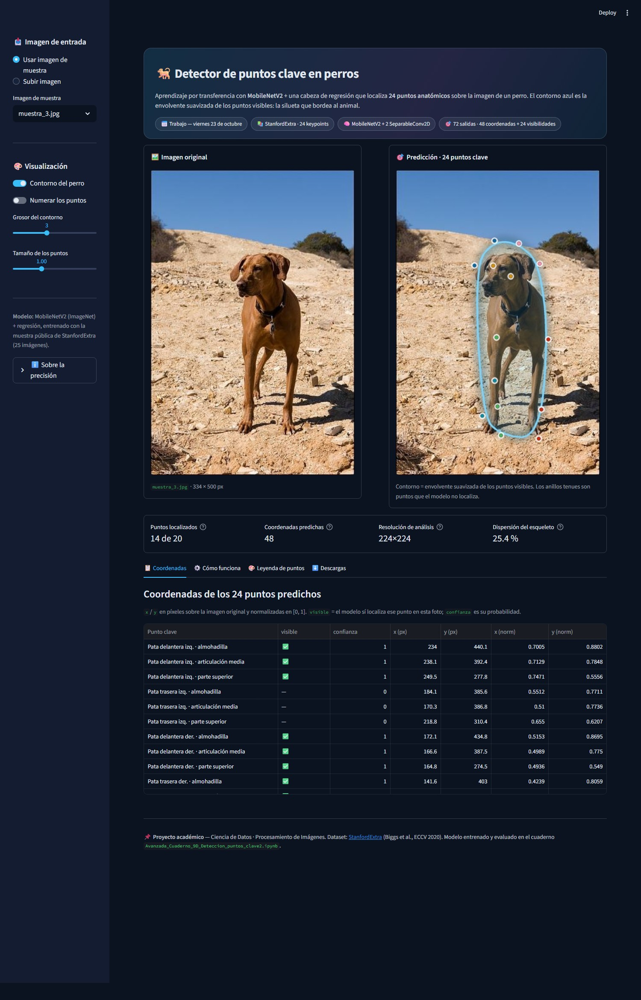
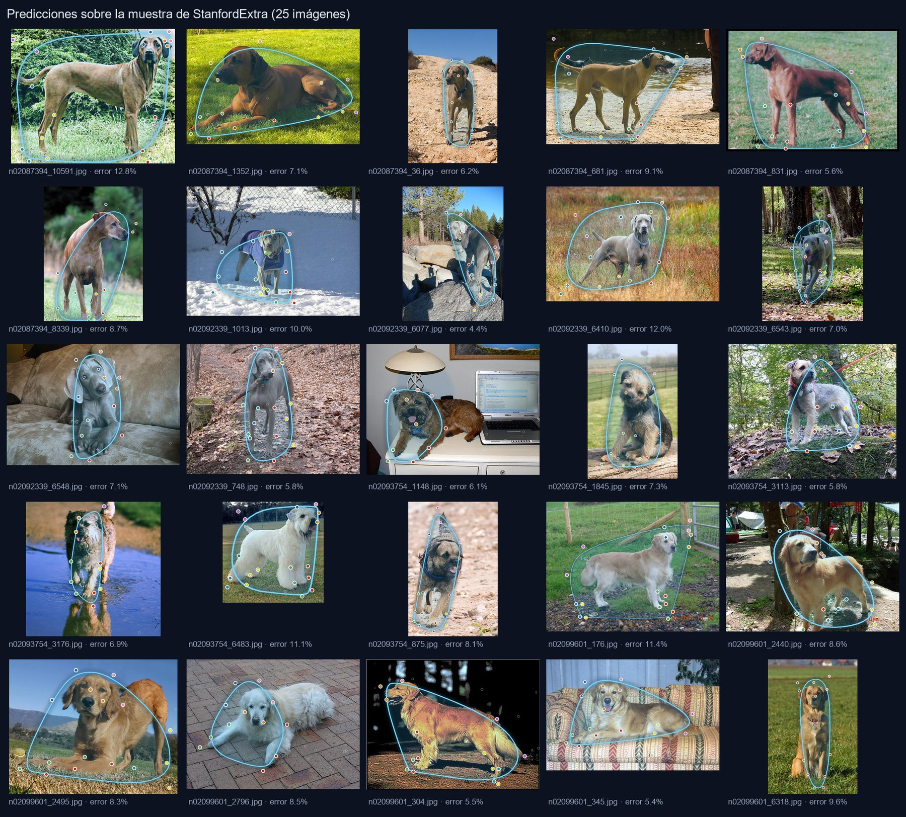

# 🐕 Detector de puntos clave en perros

Demo de **visión por computador** que localiza **24 puntos anatómicos** de un perro
(patas, orejas, ojos, nariz, cola…) sobre cualquier foto y dibuja un **contorno azul**
que bordea la silueta del animal.

Hecho con **TensorFlow / Keras** (MobileNetV2 + cabeza de regresión) y desplegado como
app de **Streamlit** lista para correr en local.



---

## ✨ Qué hace

| | |
|---|---|
| **Entrada** | Una foto de un perro (JPG/PNG) o una de las 3 muestras incluidas |
| **Salida** | 24 puntos con su color oficial, el contorno de la silueta y la tabla de coordenadas |
| **Formato** | Coordenadas en píxeles y normalizadas `[0, 1]`, visibilidad por punto, descarga en CSV y PNG |

El contorno **no es una máscara de segmentación**: es la **envolvente convexa de los puntos
que el modelo considera visibles**, suavizada con el algoritmo de Chaikin. Con los puntos
bien localizados, esa envolvente rodea el cuerpo del perro.



---

## 🚀 Instalación y uso

```bash
git clone https://github.com/Joserraldo/detector-puntos-clave-perro.git
cd detector-puntos-clave-perro
pip install -r requirements.txt
streamlit run app.py
```

Abre `http://localhost:8501`. En la barra lateral puedes elegir una muestra o subir tu
propia foto, activar/desactivar el contorno, numerar los puntos y ajustar grosores.

> El modelo (10 MB) ya viene en `modelos/`, así que **no hace falta entrenar nada** para
> probar la app.

---

## 🧠 Cómo funciona

```
Imagen 224×224×3
   → preprocess_input            (normalización de MobileNetV2)
   → MobileNetV2 · ImageNet      (último bloque entrenable)
   → Dropout(0.3)
   → SeparableConv2D(72, 5×5, ReLU)
   → SeparableConv2D(72, 3×3, Sigmoid)   → 1×1×72
        ├── 48 valores = 24 puntos × (x, y)   en [0, 1]
        └── 24 valores = probabilidad de que cada punto se vea
```

1. **Transfer learning:** se reutiliza MobileNetV2 preentrenado en ImageNet; solo se
   entrena la cola del backbone y la cabeza de regresión.
2. **Regresión de coordenadas:** `sigmoid` mantiene las salidas en `[0, 1]`, así que las
   coordenadas son independientes del tamaño de la foto.
3. **Visibilidad:** la segunda mitad de la salida dice qué puntos el modelo no ve
   (oclusiones, partes fuera de cuadro). Esos puntos no entran en el contorno.
4. **Dibujo:** todo se dibuja con Pillow a 3× de resolución y se reduce al final
   (anti-aliasing), sin dependencias de OpenCV.

---

## 📊 Precisión

Entrenado con la **muestra pública de StanfordExtra** (25 imágenes, 4 razas) y validado
sobre esa misma muestra:

| Métrica | Valor |
|---|---|
| Error medio por punto (puntos visibles) | **≈ 7,9 %** del tamaño de la imagen |
| Error mediano | ≈ 7,3 % |
| Acierto de visibilidad (20 puntos anotados) | **100 %** |
| Parámetros del modelo | 2,35 M (1,78 M entrenables) |

⚠️ **Es una demo, no un detector de producción.** Con 25 imágenes de entrenamiento el modelo
acierta en perros parecidos a los de la muestra; para uso real habría que entrenar con el
dataset completo de [StanfordExtra](https://github.com/benjiebob/StanfordExtra) (12.000
imágenes, se solicita a los autores) o con un modelo específico de pose animal.

Detalle importante del dataset: la muestra **nunca anota** los puntos 20-23
(ojo izquierdo, ojo derecho, cruz y garganta). Por eso la app los dibuja como anillos tenues
y no los usa para el contorno.

---

## 📁 Estructura

```
detector-puntos-clave-perro/
├── app.py                      # interfaz Streamlit
├── puntos_clave.py             # inferencia, contorno y dibujo (reutilizable)
├── modelos/
│   └── modelo_puntos_clave.keras
├── muestras/                   # 3 fotos de ejemplo
├── docs/                       # capturas para este README
├── .streamlit/config.toml      # tema
└── requirements.txt
```

`puntos_clave.py` se puede importar desde cualquier script:

```python
from PIL import Image
from puntos_clave import cargar_modelo, predecir, dibujar

modelo = cargar_modelo("modelos/modelo_puntos_clave.keras")
img = Image.open("muestras/rhodesian_1.jpg").convert("RGB")

kps, vis = predecir(modelo, img)     # (24, 2) en [0,1]  y  (24,) de visibilidad
dibujar(img, kps, vis=vis).save("salida.png")
```

---

## 📚 Créditos

- **Dataset:** [StanfordExtra](https://github.com/benjiebob/StanfordExtra) — B. Biggs et al.,
  *Who Left the Dogs Out? 3D Animal Reconstruction with Expectation Maximization in the Loop*
  (ECCV 2020). Imágenes del [Stanford Dogs Dataset](http://vision.stanford.edu/aditya86/ImageNetDogs/).
- **Modelo base:** MobileNetV2 (Sandler et al., 2018) vía `keras.applications`.
- **Idea del cuaderno:** *Detección de puntos clave con aprendizaje por transferencia*
  (Alfredo Díaz Claro, sobre el trabajo de Sayak Paul y Muhammad Anas Raza).
- Código, app y reentrenamiento: **José Alejandro Téllez Prada**.

## 📄 Licencia

MIT — ver [LICENSE](LICENSE). El dataset StanfordExtra tiene su propia licencia
(uso académico); revisa su repositorio antes de redistribuir imágenes.
